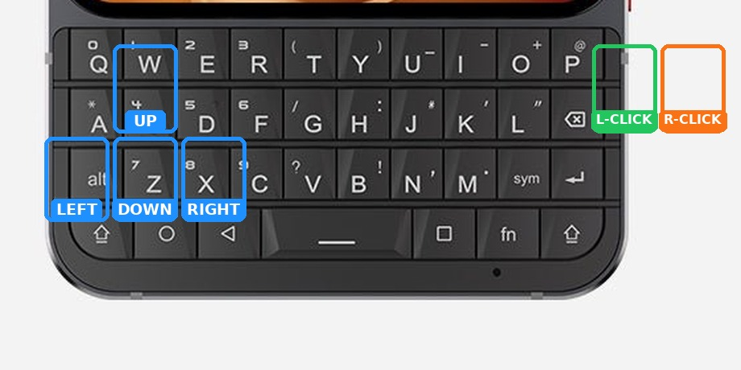
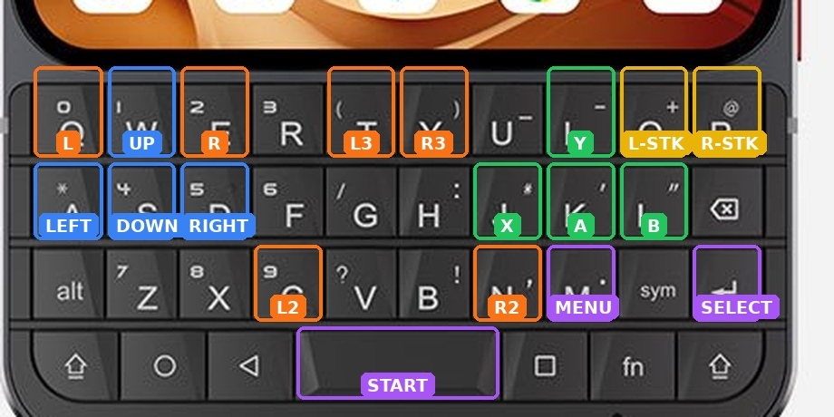

# Titan Gamepad

A virtual controller driver for the Unihertz Titan 2 Elite. It translates
the phone's own physical QWERTY keyboard into a real UHID device, so any
app that supports a controller — emulators, games, streaming apps — sees
a controller, not a keyboard. No Titan Boy shell, no RetroArch fork,
no root.

It has two profiles in one app, cycled from the single launcher icon:

**Off → Mouse → Controller → Off**

Each launch moves to the next profile and shows a short toast naming it:
"Mouse mode.", "Controller mode.", or "Off." The toast lasts about a
second. Press X at any time to hear the current mode (note: that toast
comes from the service, so it does not always show).

## Mouse mode

The keyboard becomes a real UHID mouse. Android shows the system cursor
while the mouse device exists and hides it when you switch away from
mouse mode — no overlay code is needed.

- Move: **W / A / S / D** (hold to keep moving; speed ramps up)
- Scroll: **I = up, J = down**
- Clicks: **K = left click, L = right click**

## Controller mode

The keyboard becomes a real UHID gamepad. Cannoli was just how it was
tested and verified; nothing in the driver is specific to one emulator.

- D-pad: **W / A / S / D** (hat switch; diagonals work)
- Face: **K = A, L = B, J = X, I = Y**
- Shoulders: **Q = L, E = R, C = L2, N = R2, T = L3, Y key = R3**
- **Enter = Select, Space = Start, M = Menu** (Cannoli's In-Game Menu)
- **O** toggles WASD between D-pad and left stick
- **P** toggles KLJI between face buttons and right stick
  (right stick by position: I up, J left, K down, L right)

Button bits follow Cannoli's gamepad tester order (it counts C and Z as
buttons, so X is bit 3, Y is bit 4, L is bit 6, R is bit 7, Select is bit 10,
Start is bit 11, Mode is bit 12, L3 is bit 13, R3 is bit 14). L3/R3 bits are
an extrapolation — they have not been tester-verified.

## No UI, no stray typing

None of these apps have a UI. They are toggled from the Titan 2 Elite's
built-in keyboard shortcut settings.

While a profile is on and its device is actually running, every
non-mapped key is also blocked — letters, numbers, symbols, Space,
Enter, Tab, Shift, and so on — so nothing can leak through as typing.
Home, Back, and volume always pass through, so you can always reach the
launcher to turn it off. If a device fails to start, keys pass through
normally instead.

## Modes are always known

Every time controller mode starts, it starts in D-pad + face-button mode.
Stick modes do not persist silently across toggles.

## Stuck directions

If a key-up event is ever lost, a direction can stick. Two things fix it
without toggling the driver off:

1. Tap the stuck key again — a fresh press for an already-pressed direction
   clears it (held-key repeats are filtered out, so normal holds are safe).
2. Press O to flip the stick mode — flipping clears the WASD state.

Toggling the driver off sends a neutral report and clears all state. If a
menu (Cannoli's, especially) keeps scrolling after the driver is off, that
is the menu latching its last input — force-closing the app clears that side.

## Permissions

1. Accessibility: Titan Gamepad ON. Android will warn it can observe keys —
   that is exactly how mapped keys are consumed. The service does **not**
   read window content, and there is no network code.
2. Shizuku: grant Titan Gamepad in the Shizuku app, so it can create the
   UHID device. Shizuku must be running; after a reboot, restart it.

## Safety rule

A mapped key is consumed **only while the virtual device is actually
running**. If device creation fails, keys pass through untouched — the
driver never steals a keyboard it cannot replace.

## How it works

- `GamepadAccessibilityService.java` — input path, profiles, mode
  cycling, state, and the mouse movement ticker.
- `GamepadMapping.java` — the controller key-to-button table and
  pressed state.
- `UhidDevice.java` — minimal UHID gamepad, written from the kernel
  `uhid.h` header (CREATE2=11, INPUT2=12, 4376-byte events).
- `UhidMouseDevice.java` — minimal UHID mouse (3 buttons, relative
  X/Y, wheel), same UHID framing.
- `UhidHelper.java` / `UhidMouseHelper.java` — the same device code run
  as the shell user via Shizuku's `app_process`, fed `STATE …` lines.
  This is the path that actually works on this phone; direct `/dev/uhid`
  from a normal app is almost never openable.
- `GamepadActivity.java` — the silent launcher that cycles the profiles.

## Test steps

1. Sideload, grant Accessibility + Shizuku.
2. Launch the Titan Gamepad icon once — it should toast "Mouse mode."
   and the system cursor should appear.
3. **Suppression check first:** open a text field with a profile ON and
   press a letter. No letter must appear. If one appears, turn the
   driver off and report that — do not play with it on, or you will
   get double input.
4. In mouse mode, test movement, scrolling, and both clicks. In
   controller mode, test every button in a gamepad tester, then a
   simple game with gamepad input (not keyboard input).
5. Launch the icon to cycle to Off before typing elsewhere.
